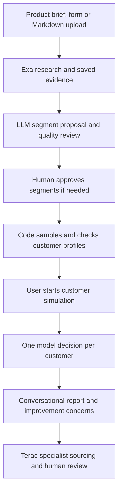

# Customer Labs

Customer Labs helps product builders explore who might choose their product, why others might pass, and what to improve before launch. Upload a product brief, collect market evidence, review customer segments, and simulate individual buying decisions against competing offers and the option to keep an existing solution.

**Customers and decisions are synthetic.** They are research hypotheses—not surveyed buyers, verified demand, sales forecasts, or real purchases.

## What it does

- Researches competitors, reviews and discussions through Exa, preserving evidence and source references.
- Proposes customer segments and sampling distributions with an LLM.
- Constructs structured customer profiles reproducibly in code, with schema, coverage and consistency checks.
- Pauses for segment approval before creating the final population.
- Simulates each customer's choice, including competitors, keeping their current solution or declining to buy.
- Produces a conversational report with individual reasons, segment feedback and proposed improvements.
- Builds evidence-linked concerns and specialist requirements for Terac human review.
- Includes a separate Whop payment/intake integration under development.

## Architecture



The workflow uses bounded stages, saved responses and local validation. It is not an unrestricted autonomous agent. Research findings and assumptions remain distinct; simulated segment counts describe demo coverage, not market share.

## Requirements

- Python 3.11 or newer.
- An **OpenRouter LLM API key**, model ID and sufficient provider balance.
- An **Exa API key** for live research.
- Optional Terac credentials for specialist sourcing.
- Optional Whop credentials for the separate payment integration.

**A Lovable account or deployed Lovable worker is not required for the setup below.** Direct LLM access currently uses the OpenRouter adapter; an arbitrary provider key cannot be substituted without an adapter. The legacy worker integration remains in the source for existing deployments.

## Run locally

From the repository root:

```sh
python3 -m venv .venv
source .venv/bin/activate
python3 -m pip install -e ./backend
cp backend/.env.example backend/.env
```

Edit `backend/.env` locally:

```dotenv
MODEL_BACKEND=openrouter
EXA_API_KEY=your_exa_key
OPENROUTER_API_KEY=your_openrouter_key
OPENROUTER_MODEL=your_supported_model_id
```

Choose a model available to your OpenRouter account that supports the structured-output parameters used by the adapter. Model availability, limits and pricing depend on the provider. Keep secrets out of frontend code and Git.

Start the application:

```sh
python3 backend/scripts/run_demo.py --customers 25
```

Open [the local application](http://127.0.0.1:8082/). Upload a `.md` brief or enter product details, click **Check your work**, then **Start**. Review and approve the customer segments, inspect the generated profiles, and start the simulation. Evidence, profiles and reports open as readable pages.

Use `--customers 10`, `50` or up to `500` to set the requested population size. Larger runs require more calls, time and provider budget; this is not a guarantee of successful completion at every size. Use `--port 8083` if the default port is occupied.

Previewing a brief does not call the model. Starting research and subsequent model stages consume your configured services' credits. Opening a completed concern-bearing journey can initiate Terac feasibility requests when Terac is configured. Feasibility checks are separate from recruitment or hiring.

## Product brief

Start with [the blank template](data/demo-briefs/product-brief-template.md), [CodeSensei](data/demo-briefs/codesensei.md), or [the speaker example](data/demo-briefs/speaker.md).

Provide a product name, short description, planned price and billing period, and the features you want evaluated. Audience, market and a research question improve the research when known. Do not invent missing facts. Clearly distinguish hypothetical specifications from measured performance.

## Outputs and recovery

Local outputs are saved under:

| Location | Contents |
| --- | --- |
| `data/runs/<run-id>/` | Brief, research, model responses, segments, profiles, validation and approvals |
| `data/journeys/<run-id>.json` | Connected workflow progress |
| `data/simulations/<run-id>/` | Individual decisions, usage, report HTML/Markdown and review concerns |
| `data/terac/` | Expert sourcing records |
| `backend/var/` | Private payment database and expert workspaces |

Normal home navigation starts with a fresh screen. To reopen a particular saved journey, use `http://127.0.0.1:8082/?run=<run-id>`. Use the available resume controls rather than starting a duplicate run. Some ambiguous failed requests require an explicit retry and may already have incurred provider charges. Completed responses are reused where supported; incompatible or invalid saved output is not silently accepted.

Generated runs, local state, credentials and research caches are excluded from Git. Keep your own backups if you need to retain them across machines or deployments.

## Terac human review

The Terac integration uses MCP to request specialists matched to the concern and relevant category experience. The configured target is one English-speaking specialist who resides and works in the United States per improvement. Screening questions and experience requirements are prepared automatically.

A feasibility response is not a named expert or a hired worker. Profiles and screening answers are available only when the provider returns applicants. Drafting, recruitment, invitations and completed expert work are distinct steps; the application does not guarantee immediate availability or automatically launch recruitment.

## Whop payments

The repository includes checkout/payment verification, paid intake, local order storage and fulfillment scaffolding. **The full paid service is not production-ready:** public HTTPS hosting, signed webhooks, live end-to-end payment verification, tier-based customer counts and complete simulation delivery still require integration and testing. Existing fulfillment code must not be assumed to enforce the advertised 10/50/100-customer tiers.

Keep `WHOP_SALES_ENABLED=false` until the paid path is ready. Real payments and payouts are separate capabilities. Never treat synthetic purchases as real revenue. Whop is the intended payment provider for this hackathon build; Stripe is not needed.

## Repository layout

```text
backend/
  scripts/                  Local demo, simulation and integration commands
  src/customer_generation/ Research, segmentation, sampling, validation and UI
  src/customer_simulation/ Individual decisions and conversational reports
  src/terac_integration/   MCP sourcing, screening and review tools
  src/whop_integration/    Payment verification, intake and fulfillment
  tests/                    Offline and mocked regression tests
  workers/                  Legacy Lovable bridge source
data/
  demo-briefs/               Example product inputs
  schemas/                   Shared JSON contracts
  products/                  Prepared example specifications and datasets
  tools/                     Local data utilities
docs/                       Supporting documentation
```

## Tests

```sh
PYTHONPATH=backend/src python3 -m unittest discover -s backend/tests -v
```

Offline/mocked tests check contracts, sampling, recovery and integrations. They do not establish real buyer behavior, current provider availability or successful live payment delivery. No paid model calls are needed to run the unit suite.

## Current limitations

The local server binds to localhost and is a development/demo server, not production hosting. GitHub stores source code; pushing this repository does not deploy it. Production operation requires durable storage, appropriate access controls, a public HTTPS service and provider configuration. LLM output can fail validation or contradict a segment; saved state and targeted retries reduce rework but do not eliminate failures. Token ceilings are safeguards, not advance billing reservations; set account-level spending limits with your provider.
