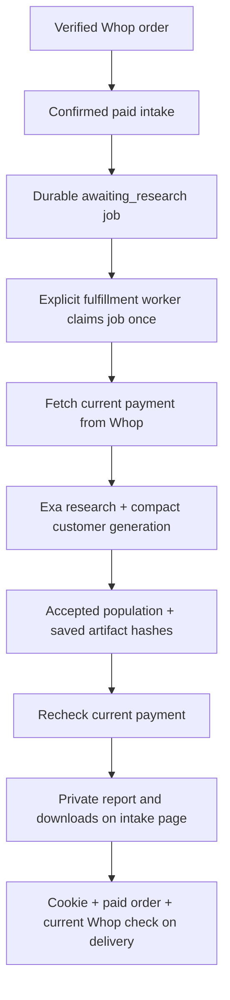

# Whop integration — phases 1–3

Checkout/order ledger, signed webhook ingestion and paid intake are implemented locally. The public service has not been deployed, no webhook has been registered, and no real payment has been tested. Sales remain closed. Paid generation execution and private report delivery are implemented in phase 3. Public deployment and an actual paid journey are still unverified.

## Phase 2 — paid intake implemented

Open `/intake?order=<order-id>` or the checkout return URL on the local service. The page verifies payment through the order-cookie-protected API before allowing preview/submission. Loading the page never establishes payment. Without a valid paid order, it remains locked.

- Minimal form: product name and description required. Optional planned price, type, features, audience, market and research question are inside a disclosure.
- Local `.md` file picker (UTF-8, up to 64 KB). Browser sends contents, not a filesystem path. Known headings are parsed by code; arbitrary prose is not sent to an LLM and is not guessed. Duplicate headings are rejected. Unknown sections remain in source material and produce a warning.
- Editable form plus structured preview. Missing optional facts remain null/unknown. A missing research question gets an explicit, editable general system question. Price accepts an explicit amount and three-letter currency, e.g. `119 USD one-time`; ambiguous `$100` remains unknown with a warning and the original text retained.
- Confirmation revalidates canonical intake server-side and atomically creates one `research_jobs` record linked to the paid order. Exact retries return the existing job; changed resubmissions return 409. Submission queues a job; it never starts model calls in the HTTP request. An explicitly started phase-3 fulfillment worker processes it.
- Original uploaded text, confirmed fields, canonical brief and input hash are stored privately in the local database. Untrusted Markdown is displayed through textContent/form values, never rendered as HTML. Refund revocation locks access and marks the queued job payment_revoked.

Routes: POST `/api/orders/{id}/intake/preview`, POST `/api/orders/{id}/intake/submit`, GET `/api/orders/{id}/intake`. All require the corresponding order cookie and paid state. Downloadable template: `/intake-template.md`. Ready-to-select local files: `data/demo-briefs/product-brief-template.md` and `data/demo-briefs/sony-speaker.md` (derived from the existing confirmed Sony brief).

There is no production bypass for demo access. Tests use a separate temporary ledger and synthetic paid orders. The public Whop/webhook prerequisites from phase 1 still apply. Phase 3 checks current Whop payment eligibility before generation and before report publication/delivery.

## Four phases

1. Payment foundation: product/variant, server-owned checkout, verified payments, durable webhook inbox.
2. Paid intake: minimal form or local Markdown upload, editable extraction preview, order-linked job.
3. Fulfillment: generation results and report delivery.
4. Demo loop: simulation, Terac feedback, complete paid journey verification.

## Verified account setup

Business: `biz_dG0cGsKWFfzVvl`.
Product: `prod_N8FZ1UIcOJIxm` — Customer Research Snapshot.
Variant/plan: `plan_LAEApM6gDpAA7` — Snapshot — one product.

Read-back from Whop confirmed both resources hidden, price 9 USD once, stock zero, unlimited stock false and adaptive pricing false. This is a provisional research-service offer, not Sony hardware. Local product/plan IDs are saved in private `backend/.env`; setup record is in ignored `backend/var/whop-offer.json`. No buyer was charged. Variant title was shortened to fit Whop's live 30-character constraint.

Global account listing was denied for missing `company:basic:read`; using the supplied business ID allowed product/variant creation and retrieval with the existing key. No need to broaden account-listing permissions for that flow.

## Run locally

From repository root, using the existing Python dependencies:

```sh
PYTHONPATH=backend/src python3 -m whop_integration serve
```

Defaults to `http://127.0.0.1:8080`. A small inbox worker runs alongside the HTTP server and verifies queued payments. This is a local/demo WSGI server, not a managed production deployment. Bind only to localhost for local work. Use a reverse proxy/hosting service with HTTPS and persistent storage for deployment; multiple server replicas need a shared durable store instead of local SQLite.

| Endpoint | Behavior |
|---|---|
| GET /health | Service/environment and sales gate only |
| POST /api/checkout | Accepts `{}`; server locks price and plan, verifies current plan, creates an order and a Whop checkout configuration. Disabled while sales are closed. |
| GET /api/orders/{id} | Requires HttpOnly order cookie; exposes only that order's payment/fulfillment status |
| POST /api/webhooks/whop | Verifies raw-body signature and time window; durably queues the event before returning |
| GET /checkout/return | Informational only; does not mark an order paid |

The phase-2 UI should share this service's origin or use an explicit same-origin proxy. Arbitrary cross-origin checkout requests are rejected. Cookies are HttpOnly, SameSite=Lax, and Secure on HTTPS. Whop checkout links contain an order reference, not an order-access token.

## Configuration and going live

Relevant names are in `backend/.env.example`. Keep values private. Existing credentials were preserved and missing configuration slots prepared.

- WHOP_API_KEY: API credential, already local. Production and sandbox credentials are separate.
- WHOP_ENVIRONMENT: production or sandbox; selects the fixed API host and separate default SQLite file.
- WHOP_COMPANY_ID, WHOP_PRODUCT_ID, WHOP_PLAN_ID: configured above.
- WHOP_PUBLIC_URL: public backend HTTPS **origin**, not the Lovable model-worker endpoint. Still localhost until deployment/tunnel setup.
- WHOP_WEBHOOK_SECRET: signing secret returned by Whop; currently missing. Do not invent one or reuse the API key.
- WHOP_SALES_ENABLED: false. Keep false until the report can be delivered.
- WHOP_PRICE_USD: 9.00 provisional one-time amount. Server validates the configured plan and exact payment subtotal; discounts/local-currency conversion are not supported in phase 1.
- WHOP_DATABASE: optional persistent file path. Default `backend/var/whop-production.sqlite3` for production; `whop-sandbox.sqlite3` for sandbox.

To register a webhook after obtaining a public HTTPS backend URL:

```sh
# Plan only, no external mutation:
PYTHONPATH=backend/src python3 -m whop_integration setup-webhook
# Register after inspecting the plan:
PYTHONPATH=backend/src python3 -m whop_integration setup-webhook --execute
```

The one-time secret is written immediately to `backend/var/whop-webhook.json`, mode 0600, without printing it. Copy its `webhook_secret` privately into `WHOP_WEBHOOK_SECRET`. The file is ignored. If registration times out after Whop has created the endpoint, check the dashboard before retrying; the private file is reserved before the API call to prevent overwriting a one-time secret. Restore a missing secret through Whop's dashboard instead of bypassing verification.

Register v1 webhooks pinned to `2026-08-14`, matching the REST header. Subscribe to payment succeeded/failed/canceled, refund created/updated and dispute created/updated. Whop retries deliveries, so the handler acknowledges durable receipt instead of doing provider I/O in the request.

To create a new hidden offer elsewhere (not needed for this account):

```sh
PYTHONPATH=backend/src python3 -m whop_integration setup-offer
PYTHONPATH=backend/src python3 -m whop_integration setup-offer --execute
```

Setup uses stable idempotency keys, refuses existing records and reuses a configured product ID. Product visibility is hidden and variant stock is zero. Before consciously opening sales, configure the public backend and signing secret, verify a sandbox journey, confirm deliverability, set stock in Whop and explicitly enable local sales. No command in this phase charges a buyer directly.

## Payment trust and storage

Whop's official verifier uses the literal signing-secret bytes including `ws_`; this implementation follows the same HMAC-SHA256 behavior with the exact raw body and a five-minute timestamp window. Missing/expired/invalid signatures are rejected before storage. Event ID/body hash deduplication prevents duplicate processing and detects conflicting replays.

The background worker fetches the current Payment from Whop before unlocking intake. It checks account, product, plan, checkout ID, server-issued order metadata, paid/succeeded status, payer, currency, exact subtotal, sufficient total and no refunds. Browser query parameters, success redirects and a signed success event alone never unlock an order. Sandbox state is separated from production. Current refunds/disputes/nonpaid states revoke an already granted order; reversals remain terminal in phase 1 and require manual review if legitimately restored later.

SQLite stores only order references, hashed access tokens, provider identifiers, payment state and minimal durable event records. No API keys, signing secrets, card data or complete webhook payloads are stored in the ledger. Inbox processing is leased, retryable and crash-recoverable. Verification errors retain an event for retry with a sanitized category. One local database/one replica is the supported demo deployment.

Standalone inbox processing is available for recovery:

```sh
PYTHONPATH=backend/src python3 -m whop_integration worker --once
```

## Verification and remaining boundaries

22 focused tests pass, entirely with synthetic payments and mocked API calls. They cover signature validity/raw-body tampering/replays, business/product/plan/price mismatches, unauthorized order reads, closed sales, server-owned pricing, durable duplicate handling/restart, refund reversal and stale events, retryable provider outages, and setup defaults. Actual localhost HTTP check passed: health 200, closed checkout 403. Full backend suite: 152 tests passed before the final scoped client/setup refinements; focused tests passed again afterward.

**Not yet verified live:** checkout configuration creation, webhook registration/delivery and signing, payment read-back for an actual buyer, refunds, paid access and fulfillment. Product and variant creation/read-back are the only provider mutations completed in phase 1. Public webhook hosting and its signing secret are the remaining setup requirements.

## Official sources checked October 24

- [Whop webhook guide](https://docs.whop.com/developer/guides/webhooks): v1 signatures, raw bodies, acknowledgements, event retries and public URL requirements.
- [Official Python verification helper](https://github.com/whopio/whopsdk-python/blob/main/src/whop_sdk/lib/verify_webhook.py): literal-secret signing-key handling.
- [Create product](https://docs.whop.com/api-reference/beta/products/create-product), [create variant](https://docs.whop.com/api-reference/beta/variants/create-variant): account-owned hidden offers, pricing and stock.
- [Checkout configurations](https://docs.whop.com/api-reference/checkout-configurations/create-checkout-configuration): existing-plan checkout, metadata and purchase URL.
- [Payment reference](https://docs.whop.com/api-reference/payments/payment): server-side payment state and pricing fields.


## Phase 3 — paid fulfillment and report delivery

The existing paid-intake page now shows job progress and, after completion, a five-line population summary, segment counts, and private downloads for all customer details and evidence. It uses textContent for untrusted product/research text. Existing local demo on port 8082 is independent; no payment gate was added or bypassed there. Main demo checkout integration remains phase 4.



### Start processing intentionally

Plan only, no external calls:

```sh
PYTHONPATH=backend/src python3 -m whop_integration fulfill
```

Process at most one eligible paid order (spends Exa/Lovable credits):

```sh
PYTHONPATH=backend/src python3 -m whop_integration fulfill --execute --once
```

Omit --once to keep the fulfillment worker running. The ordinary web server still handles webhook verification in its separate inbox worker; it does not silently start generation. The same private backend/.env provides bridge/Exa/Whop configuration. No additional credentials are introduced.

The worker uses 50 profiles, compact proposal format, one correction maximum, 40,000 tokens per stage and 160,000 total. Existing budget machinery applies; bridge dollar cost may be unknown and is not a guaranteed dollar ceiling. Failed/incomplete jobs stop for operator inspection, preserving artifacts. It does not retry paid model calls automatically.

### Storage and status

SQLite research_jobs adds run_id, started_at, finished_at and last_error with an additive migration. One job per order, transactionally claimed once. Status moves from awaiting_research → processing → completed, needs_attention, or failed. Refund revocation remains terminal and cannot be overwritten by a finishing generation run. If the process crashes while processing, the job remains processing for manual reconciliation: inspect its saved state before deciding recovery. It is deliberately not automatically reclaimed and billed again.

Artifacts are under data/runs/whop-<server-generated-random-id>/, isolated from other orders. Existing pipeline files preserve Exa sources, exact inputs, evidence, specification, individual customers and usage. population-summary.md/html are generated after acceptance. delivery-manifest.json binds the brief, evidence, specification and customers to their saved SHA-256 hashes. The run ID is private and never accepted from a buyer.

### Private API

- GET /api/orders/{order}/results: status, report readiness, five summary lines, segment counts and limitations.
- GET /api/orders/{order}/results/customers: full structured customer population.
- GET /api/orders/{order}/results/evidence: parsed evidence and source references.
- GET /api/orders/{order}/results/specification: segment definitions and sampling rules.
- GET /api/orders/{order}/results/brief: confirmed product input.

All use the corresponding HttpOnly order cookie. Unpaid, wrong-owner, wrong-environment and revoked orders cannot retrieve results. Before generation, publication and completed-result delivery, the service fetches the current payment and runs the existing seller/product/plan/checkout/amount/payer verifier. Provider failures fail closed. Downloads use a fixed file allowlist; there is no user-supplied filesystem path. Incomplete populations never become deliverable reports.

### Validation and boundaries

45 Whop tests pass with synthetic payments and offline generation. Ten new phase-3 tests cover complete paid-intake → existing pipeline → private results, no duplicate spend, refunds before/during/after execution, exclusive claims and crash behavior, provider failure, incomplete generation, changed artifacts, cookie authentication and environment isolation. No actual payment, model call, checkout change or public deployment was performed for this implementation. Sales stay closed. Public HTTPS, webhook signing setup, sandbox purchase/refund verification and main demo checkout wiring remain to finish.
