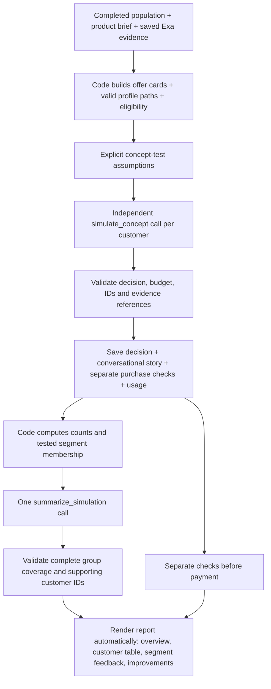

# Reusable concept simulation and conversational reports

This replaces the default CLI path. The old simulate_customer stage, old schemas, old report renderer and saved Sony reports remain archival compatibility paths. The new path does not read report-language.json, product-specific scripts, manually written customer explanations or phrase-replacement dictionaries.

## What the customer is answering

**Concept interest:** Assume the proposed offer can be bought at the submitted price and provides exactly the submitted features/targets. Would this profile prefer it over the supplied alternatives or keeping what they already use?

**Before payment:** Separately, what should the seller verify or explain before someone spends real money? These checks do not automatically count as objections to the concept. A customer can choose the proposed product and still request proof before paying.

Scenario assumptions are visibly labeled and never become verified market evidence. Genuinely unspecified benefits (e.g. no description of sound quality), hard budgets, insufficient need and switching barriers can still affect interest. No forced positive outcomes.

## Architecture



Both model stages run through the existing authenticated Lovable worker/model. No new provider, Exa requests, Terac actions, external messages, payments or agents are added. No browser or physical testing is simulated in this slice.

## Contracts

- customer-concept-decision.schema.json retains structured choices/reasons but adds customer_story: situation, reason, next_step, actual profile field paths and evidence IDs.
- purchase_checks is a separate array with a topic, question and evidence IDs. Prompts explicitly prohibit rejecting solely because the proposal is hypothetical/unannounced/unverified.
- simulation-report.schema.json requires exactly five conversational overview points, every tested segment exactly once, and up to six proposed improvements. Narratives reference saved customer IDs. Code adds the numerical decision summary as the sixth overview line.
- Segment references must equal actual tested membership; invented IDs, duplicated/missing segments, unknown evidence or invalid profile paths stop publication.
- Code retains the price/currency/billing/hard-requirement gate. Competitor prices that have not been reliably structured are not invented. These are shown as research limitations, not failures of the client's brief.

Reference checks demonstrate traceability, not psychological validity or proof that prose faithfully reflects every cited fact. Prompt quality and live output still need human inspection. Automated checks do not establish real buying behavior.

## Deployment

Upload backend/workers/lovable-concept-report-v2.zip to the existing Lovable project. Follow DEPLOY_CONCEPT_REPORT.md; publish and confirm the model-free build before paid testing. The package adds two stages and preserves the eight old stage policies exactly. No secret changes are required.

Plan (free):

```sh
python3 backend/scripts/run_simulation.py \
  --population-run demo-51c5d7d388b64960bbdb2b435d9e90dd --count 5
```

After confirming deployment, fresh five-customer concept test:

```sh
python3 backend/scripts/run_simulation.py \
  --population-run demo-51c5d7d388b64960bbdb2b435d9e90dd \
  --count 5 --approve-population --execute
```

This is six model calls: five independent customers and one report synthesis. Output allowance is 5,000 tokens per call with a conservative 160,000 total-token limit; billed USD can remain unknown. Plan mode makes no API calls. Old simulation choices cannot be relabeled as concept choices: a fresh run is needed because the question has changed.

## Output

Default folder: data/simulations/simulation-TIMESTAMP/.

- inputs.json and manifest.json: immutable input/prompt/schema fingerprint, scenario assumptions, source, limits and status.
- customer-NNN-input.json, customer-NNN-bridge-response.json, customer-NNN-raw.json, customer-NNN-usage.json: complete per-customer trail.
- customer-NNN.json: validated choice, conversational story, cited reasons, product objections, purchase checks.
- summary.json: deterministic choice/segment counts, product objections, separate payment checks, research gaps.
- report-input.json, report-bridge-response.json, report-raw.json, report-usage.json: exact synthesis trail.
- report-narrative.json: validated generated summary tied to the saved input fingerprint.
- report.html / report.md: ready to read without editorial overrides.
- progress.json and failure.json: explicit progress/failure. No final report is published when synthesis fails validation.

A failed synthesis preserves valid customer responses. Explicit --resume --output <same-folder> reuses exact saved responses without billing them again. It rejects changed input/prompt/schema fingerprints. An ambiguous network attempt with no reusable output is not silently retried, even on resume; inspect before deciding whether to spend again. There is no automatic correction/retry. Valid saved responses are revalidated on reuse.

## Report reading order

1. Scenario and what the test means.
2. Six-line overall feedback (code counts plus generated narrative).
3. Each customer's situation, budget, choice and conversational reason.
4. Each tested group's name, count, feedback and a change to try.
5. Expandable individual details with unchanged structured results/references.
6. Checks before payment, separately from interest in the idea.
7. Suggested product improvements with the specific supporting customers.

Terac is deliberately absent from this report. Its design will be discussed later.

## Population-scaled budgets and bounded report synthesis

The fixed 160,000-token default was removed after a 25-customer run stopped after 15 valid responses. Automatic ceilings now scale from all selected customer payloads plus conservative reserves for every planned report node. These are conservative upper bounds, not expected usage, dollar caps or reserved credits. --max-total-tokens can set an explicit smaller ceiling. The plan prints available profiles, customer/report call counts, the ceiling, and saved customers to reuse.

Up to 20 customers use a direct report. Larger populations are summarized in batches of at most 20, followed by a reduction tree with at most four child summaries per node. All child summaries are retained, and exact counts always use all results. Reduction inputs use actual representative customer examples by segment and decision; linked IDs are disclosed as supporting examples. Every node saves a coverage file, and the root must cover every selected customer exactly once. This avoids the strict schema's 50-ID-per-field bound and oversized final requests without changing the deployed worker schema.

Report-node payloads are bounded to 600,000 bytes and outputs scale with tested group count up to the existing worker ceiling of 24,000 tokens. All prior schema, evidence, group reference and budget checks remain. Original individual results are never discarded or replaced by summaries. No model stages, policies, hashes or Lovable deployment changes are required for this scaling change.

The saved run simulation-20261024-180849-633597 has 15 responses verified locally for reuse. To finish it without repeating them:

```sh
python3 backend/scripts/run_simulation.py \
  --population-run demo-51c5d7d388b64960bbdb2b435d9e90dd \
  --count 25 --approve-population \
  --resume --output data/simulations/simulation-20261024-180849-633597 \
  --execute
```

This needs at most 10 remaining customer calls plus 3 report calls. No paid call was made while implementing or verifying the fix.

The runner supports 25, 50 or 500 customers when that many distinct saved profiles exist. The current Sony population contains 50: count 500 correctly asks for a larger population rather than duplicating profiles. Offline integration checks cover 25/50/500 complete runs, deterministic coverage/counts, bounded synthesis inputs, budget-stop/resume without repeating calls, and refusing insufficient profiles. These checks do not measure live provider throughput or guarantee credits for hundreds of calls.

## Final reduction reference repair

A saved final summary cited real customers present in child summaries but not among the seven illustrative full responses retained at the root. The old validator incorrectly treated those seven examples as the whole source catalog. Reduction nodes now validate references against every customer covered by their children, validate cited IDs against the correct segment, still reject unknown/duplicate IDs and missing groups, and keep full population coverage checks. Large groups may cite a bounded subset of supporting examples. Direct leaf summaries retain exact group membership checks.

Future reduction requests include an explicit allowed_customer_references catalog and full covered counts. Existing saved old-format requests are reused only if they exactly match the known pre-fix input shape; their raw output is not rewritten. The 25-customer run simulation-20261024-180849-633597 was recovered locally to report.html and report.md with zero model calls. Prior failure and manifest were preserved as *-before-report-recovery.json.

The CLI now supports --render-saved with --resume --output: it never loads API credentials and uses a client that cannot make model calls. If any required response is missing, it stops instead of spending credits.
