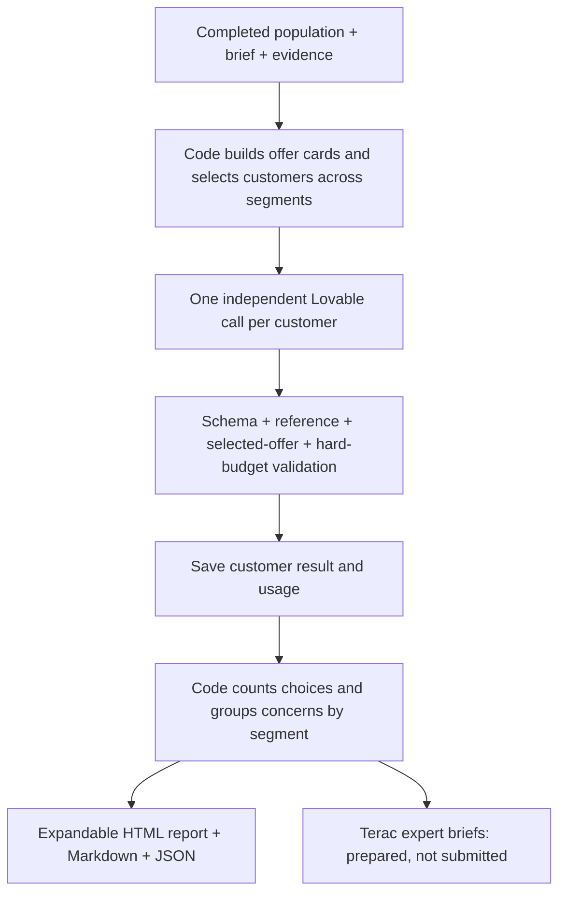

# Customer simulation MVP

Implemented: independent single-call offer comparison per customer, using the existing Lovable model bridge. This is not yet browser navigation, physical product testing, or a measured market forecast. The model sees its own customer profile, the same supplied offer cards, and extracted evidence. It never sees other customer answers.



## Deploy first

Upload `backend/workers/lovable-simulation-stage.zip` to the existing Lovable project. Follow its DEPLOY_SIMULATION.md: preserve routes/secrets/runtime, add policy/validators, rebuild deployment metadata, publish, confirm production. No provider call has been made by this implementation. Existing generation stages remain present.

## Plan without API calls

```sh
python3 backend/scripts/run_simulation.py \
  --population-run demo-51c5d7d388b64960bbdb2b435d9e90dd --count 5
```

After deployment confirmation and reviewing the population, explicitly execute:

```sh
python3 backend/scripts/run_simulation.py \
  --population-run demo-51c5d7d388b64960bbdb2b435d9e90dd \
  --count 5 --approve-population --execute
```

Reads private bridge settings from backend/.env without printing them. Five customer calls, no Exa retrieval, no automatic retries. Each completion is capped at 3,000 tokens; the run has a conservative 80,000-token budget. Billing in USD is unavailable from the bridge, so this is a token bound, not a verified dollar cap. Initial results require human inspection before increasing count.

## Saved files

Each run is under data/simulations/sony-TIMESTAMP/:

- manifest.json: source run, input fingerprint, limits, status, usage.
- inputs.json: exact population subset, evidence, offer cards and instruction fingerprint.
- input-NNN.json / raw-NNN.json / usage-NNN.json: each model request payload, returned canonical result, usage metadata.
- customer-NNN.json: schema/semantic validated result only.
- summary.json: deterministic counts, segment breakdown, concerns and customer IDs.
- report.html: expandable detailed customer results; open directly in a browser.
- report.md: concise readable customer reports.
- terac-review-briefs.json: issue category, relevant specialty, supporting concerns/customer IDs, review question and deliverable. No expert has been contacted/hired.
- failure.json: explicit stop; prior accepted results remain saved. No automatic paid correction/retry.

Resumption with the same output directory reuses complete validated results and rejects changed inputs. A failed directory cannot be automatically retried. Inspect its saved artifacts first. Use --output only to select an intentional output directory.

## Meaning and limits

Decisions: choose_product, choose_alternative, keep_current, defer. Reasons reference real profile field paths and supplied finding IDs. Code verifies those references and budget/currency/billing consistency; it cannot prove the model's explanation is factually or psychologically correct.

Competitor cards preserve source claims and missing information. Aggregate comparison pages with ambiguous model alignment are excluded. The current importer does not convert arbitrary competitor price strings into confirmed price/currency/billing terms: an alternative with incomplete terms cannot produce an unconditional purchase selection. The model can flag the missing information and defer. This limitation is material and should be reviewed before comparing simulated choice counts.

Hard requirements beyond a comparable price ceiling are not yet interpreted; a purchase selection with an unsupported hard requirement stops for inspection. No inferred physical defects or website UX failures. Hardware concerns route to category engineering, price/positioning to relevant commercial expertise, usability to UX, service delivery to operations. The concern remains synthetic until independently assessed.

Terac API submission and simulation UI controls are not implemented in this first slice. The existing generation demo remains available; simulation is launched from the terminal and reports open as HTML. A later offer experiment should reuse identical profiles and document changed offer terms.

## Local response-contract fix

The first live simulation response reached Python but was rejected because the model-bridge-response stage enum omitted simulate_customer. Added the stage locally; no Lovable redeployment is required. Regression coverage now runs five complete customers through the actual Python ModelBridgeClient with offline transport, and checks every registered stage against the response contract. Simulation now saves bridge-response-NNN.json before client validation, retaining responses/usage for future diagnosis. The earlier discarded response cannot be recovered from local artifacts. No paid retry was made while repairing this.

## Saved pilot recovery

The five-customer pilot sony-20261024-172729-977738 saved all five model outputs; the fifth used requirements.price instead of an indexed requirement path. The resolver now supports unique exact attribute-keyed list references. Missing, differently cased and duplicate attribute matches still fail. New requests include an explicit list of indexed profile_field_paths. No prompt/policy change or Lovable republish is needed.

All five archived outputs passed local revalidation and were replayed into data/simulations/sony-20261024-172729-recovered/report.html, without a new provider call. The original failed run is preserved. --replay-from plus --output can perform the same local-only recovery for a complete set of archived responses; input fingerprints and customer payloads are checked, and existing output directories cannot be overwritten.

## Updated report presentation

The report now starts with a six-line overview, a customer table (situation, budget, choice, plain-language reasons), feedback grouped by segment with tested counts, expandable individual reasons and suggested changes, and an improvements sidebar ordered by the number of affected pilot customers. Changes are proposed experiments, not verified fixes. Common technical phrases are replaced only in the display; original model responses and evidence references remain expandable and saved unchanged.

Per user direction, the updated screen has no Terac panel, review button, hiring, interview or expert-submission workflow. Existing saved Terac artifacts are not part of this report change; that integration will be discussed later. Saved reports can be regenerated from validated results locally, with no LLM calls. The recovered five-customer Sony report was updated in place.

## Conversational Sony explanations

The recovered Sony report has an editorial report-language.json bound to the exact saved input fingerprint. It rewrites all five customer situations, reasons and next steps, four segment descriptions, six overview lines and proposed improvements in everyday language. The raw customer responses, evidence and decisions are unchanged and remain expandable. These paraphrases are not new model outputs or real customer quotes. Other runs fall back to the generic report until they receive reviewed editorial text; this change does not claim automatic conversational summaries for arbitrary future products. No calls or worker policy changes were made.

## Default pipeline updated

The CLI now uses the reusable concept-interest-v2 and conversational-report workflow. Read concept-simulation-v2.md for the current design, worker deployment, contracts, costs and commands. Earlier sections document the legacy pilot and its manual Sony editorial wording; that wording is not used by new runs.
