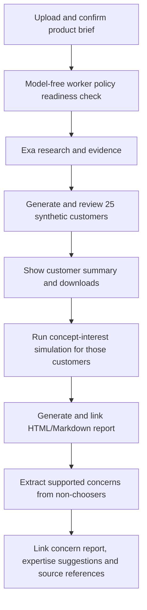

# Simple research demo screen

Run from repository root:

```sh
python3 backend/scripts/run_demo.py
```

Open **http://127.0.0.1:8082**. Keep the server running during research. This screen is local-only and separate from the verified paid Whop intake; it does not bypass payment in the customer-facing API. It has no simulation UI or simulation execution. Existing simulation plans/data were preserved.

1. Enter a product name/description, or select a `.md` or `.dotm` file.
2. Inspect the preview and edit fields. Optional missing details remain unknown. Unsupported prose is retained, not guessed.
3. Click **Start research & profiles**. Only this action starts paid Exa and Lovable calls. The same compact pipeline runs research, proposal, deterministic sampling of 50 profiles and quality review with at most one correction.
4. Watch stage/status. A completed run shows its five-line segment summary and a customer-profile download. Incomplete/failed runs remain explicit and do not expose a final accepted profile download.

Uploads: Markdown up to 64 KB; `.dotm` up to 1 MB packed with bounded XML/expanded sizes. Word document paragraphs/headings are read from `word/document.xml`; macros, OLE content, linked resources and embedded code are not executed or fetched. Templates lacking recognized headings require manual field completion. Files are not executed or extracted onto disk. Only extracted text enters the intake pipeline.

Runs are saved under `data/runs/demo-<random-id>/`. The model bridge is selected explicitly; there is no fallback to the chat/Codex model. Existing private credentials in `backend/.env` stay server-side. The localhost server uses a per-launch demo token and Host/Origin checks; do not expose this unauthenticated demo service publicly. It is not a deployed Whop storefront.

## Inspect research and customer-generation inputs

Use **Saved research and pipeline details → select run → Show research & pipeline inputs**. This reads saved artifacts only and does not use credits. Refresh runs to see progress; no new generation is started. The view shows confirmed input, Exa query batches and bounded page text, offer subjects, clickable source links, parsed findings/basis/source IDs, exact harness inputs, compact proposals, constructed sampling specification, quality reviews and completed profiles.

Within `data/runs/<run-id>/`:

| File | What it contains |
|---|---|
| brief.json | Confirmed user product data, including uploaded materials |
| call-01-research-retrieval.json | Exa query batches, source catalog and bounded retrieved snippets |
| evidence.json | Model-extracted subjects/attributes/values, evidence basis, source references and limitations |
| call-02-request.json | Harness proposal input: brief, parsed evidence, count and seed |
| call-02-compact_propose-input.json | Exact model context including code-owned category catalog, for new runs after this update |
| call-02-compact_propose-raw-output.json | Compact segment/distribution proposal returned by the model |
| specification-0.json / specification.json | Code-constructed candidate / accepted canonical sampling specification |
| customers.json | All accepted individual profiles; only published after review acceptance |
| review-0.json / review-1.json | Reviewer decisions, warnings and blockers |

Call numbers differ if intake extraction/corrections add calls. New retrieval batches include source IDs per query; old runs do not retroactively acquire missing metadata. Research tracks describe query intent; individual findings carry their actual classification. Official claims, anecdotal observed reports, assumptions and unknowns remain distinct. Offer subjects can include the client's own product, and limited Exa search results are not an exhaustive competitor census. The inspector displays the actual retrieved material and missing-evidence limitations rather than inventing a list of reviews or competitors.

Tests cover Markdown and `.dotm` parsing, malformed archives/XML, size limits, local access controls and a full background pipeline with mocked APIs. A browser check verified preview without starting research. No live API/model calls were made while building/testing this screen. Public payment integration and report fulfillment remain separate later work.

## Connected local journey (current default)

Run one command from the repository root:

```sh
python3 backend/scripts/run_demo.py
```

Then open http://127.0.0.1:8082/, upload any product .md/.dotm brief (including CodeSensei), preview/edit it, and click Start complete pipeline. The launcher now uses 25 customers by default. --customers can select another count up to 500; the generation and simulation counts stay the same. Starting authorizes the connected stages to spend configured Exa/Lovable credits. Preview/page load spends no model credits.



No CLI handoffs or copied run IDs are required. No Whop purchase, Terac integration, expert contact or hiring is added. This remains a local demo separate from the paid Whop flow.

### Stage outputs

- data/journeys/demo-ID.json: durable orchestration state, stage events and output locations.
- data/runs/demo-ID/: brief, Exa retrieval, evidence, proposal, sampling specification, 25 profiles and population summary.
- data/simulations/demo-ID/: all customer simulations, usage, batch summaries, final HTML/Markdown report.
- data/simulations/demo-ID/review-concerns/: candidate catalog, grouping/validation trail and concern HTML/Markdown/JSON.

The browser polls current stage and shows profiles as soon as generation completes, then simulation progress, report links and concerns. Earlier outputs remain available if a later stage stops. Saved runs can be inspected after refresh/restart. Reports use authenticated local endpoints and browser Blob URLs; server-supplied fixed filenames prevent arbitrary filesystem access. HTML artifact endpoints add a restrictive CSP. No keys are included in URLs.

### Explicit recovery

A failed/interrupted journey with completed generation offers Resume saved journey. It reuses existing generation and saved simulation/concern responses, with no automatic paid retries. Missing or invalid saved responses can still require inspection; ambiguous network attempts are never silently repeated. Generation itself is not resumable, so a failed generation requires an intentional new brief/run. Existing generation-only runs remain readable through the inspector.

### Worker readiness

All three new model stages must be published: simulate_concept, summarize_simulation and extract_review_concerns. The latest package is backend/workers/lovable-review-concerns-v1.zip. It preserves the previous stages and adds concern grouping. The production worker was checked while connecting this flow: concern generation returned 403 Stage or model not allowed, so this package still needs publishing.

Before a full journey starts, the local server sends exact policy envelopes with max_tokens=0. The known worker validates policy, then rejects the zero allowance before gateway/model inference. Expected 400 confirms policy alignment; 403/409 or connectivity failures stop the journey before spending research/model credits. Those deliberately rejected probes can appear in HTTP logs; they are not model executions. No model calls were made to connect or test the workflow.

Seven connected-journey tests cover actual offline generation → 25 customer simulations → batched report → concerns, stage artifact access, token/path restrictions, saved reports, failure isolation, readiness rejection, and resume without repeating completed calls.


## Guided screen

The default launcher now pauses after research and segmentation review. Upload or type a brief, choose **Check your work**, then **Start**. Read the collected evidence without a second research approval. Review the segmentation cards and choose **Approve customer segmentations** to construct the final profiles. Counts and profile cards update from saved progress. Choose **Start simulation** after profiles finish. Completed customer choices appear as they arrive; the final report appears on the page.

Waiting checkpoints survive server restarts. Approvals are bound to the reviewed files; edited inputs require fresh approval. Research and segmentation preparation still use Exa/Lovable credits. Profile construction and progress displays use local code; simulation/report model calls use the configured Lovable worker. No expert is hired. Internal pilot profiles are used for quality review before final publication.
