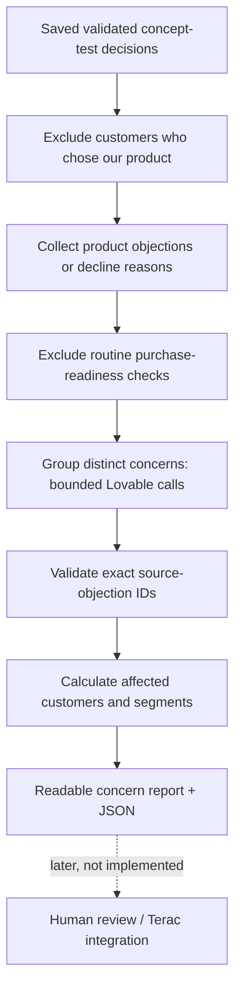

# Concerns worth human review — generation only

Purpose: turn reasons simulated customers did not choose a proposed product into a small, useful list of concerns a real person could investigate. This works across product categories. It is not expert hiring, study launch, MCP configuration or integration with Terac.

## Flow



Use the current local simulation's validated individual customer files even if its final narrative report failed. Partial customer coverage is explicitly disclosed. Legacy v1 purchase-readiness decisions are not silently treated as v2 concept-interest data. Input fingerprints and each customer decision are checked before use.

Target five to ten distinct supported concerns, but return fewer when appropriate. Never pad. Synthetic concerns are not real confirmed defects. Model grouping may still need human inspection; reference validation proves traceability, not substantive correctness.

## Each concern contains

- Plain-language title and what stopped the customer.
- Why a person could help investigate it.
- Suggested role/specialty, never a claim that a particular expert is available.
- A focused review question and one test to try.
- An observable success criterion, without invented conversion targets.
- Whether review could plausibly help, is uncertain, or is unlikely to help (e.g. little need or an uneconomic budget gap).
- Exact supporting signal IDs, customer IDs, distinct affected-customer counts and segment breakdown.

Customer counts/ranking are calculated by code. A simulated customer may raise several concerns; counts across concerns are not additive. Hiring someone is never presented as a guarantee of better sales.

## Scope boundaries

Only choose_alternative, keep_current and defer responses supply signals. Buyers' positive feedback and purchase_checks are excluded. Requests to verify hypothetical certification/availability/performance solely because it is a concept should be filtered out by the extraction instructions. A genuinely absent description of a needed benefit can remain a concern. Missing competitor data is a research limitation, not a seller defect.

Sources are grouped in batches of at most forty signals, further split by request byte size, then merged with at most four summaries per node. Merge calls receive all allowed source IDs from their child concerns, rather than representative-only IDs. Maximum ten final concerns; no source rewriting or invented customer evidence.

## Deployment

Upload backend/workers/lovable-review-concerns-v1.zip to Lovable and follow DEPLOY_REVIEW_CONCERNS.md. This adds one stage while preserving the ten existing policies. Publish and confirm the model-free check before an authenticated generation call. No Terac key is read by this feature.

Free plan / source inspection:

```sh
python3 backend/scripts/generate_review_concerns.py \
  --simulation-run simulation-20261024-180849-633597
```

After confirming the worker stage is live:

```sh
python3 backend/scripts/generate_review_concerns.py \
  --simulation-run simulation-20261024-180849-633597 \
  --execute
```

The current saved dataset has 25 validated customer results, 22 non-choosers and 31 raw candidate signals. Those are not 31 distinct concerns. The final grouping has not been generated with a live model yet.

Output: data/simulations/<run>/review-concerns/<timestamp>/.

- inputs.json: exact source catalog, product, source-input fingerprint and instructions.
- concerns-*-input/bridge-response/raw/usage.json: complete generation trail; same-call replay avoids repeating paid calls.
- concerns.json: validated, enriched concern candidates with customer counts and source references.
- concerns.html / concerns.md: readable report.
- manifest.json: status, usage, zero experts contacted, no Terac connection.

--resume --output <same-directory> reuses exact saved responses, with no automatic correction/retry. Ambiguous calls without a reusable response are not silently repeated. No model call was made to implement this feature. Live output quality remains unverified.
